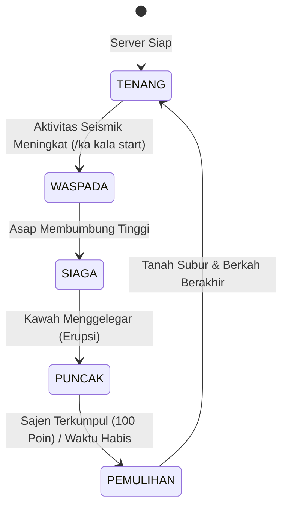

# Kala Nusantara — UI, Gameplay & Crossplay Implementation Report v5.0

**Proyek:** Kala Nusantara RPG — Nusantara Survival Co-op Server  
**Dokumen Induk:** `docs/Kala-Nusantara-Master-Design-v2.0.md` & `docs/Kala-Nusantara-UI-Gameplay-Crossplay-Expansion-v4.md`  
**Waktu Eksekusi:** 24 Oktober 2026, 21:55 WIB  
**Target Platform:** Paper 26.3-218 (Minecraft 26.3), Java Edition & Bedrock Edition MCPE (via Geyser 2.12.0 / Floodgate 2.2.5)  
**Status Implementasi:** ✅ **VERIFIED & OPERATIONAL DI SERVER STAGING/PRODUKSI**

---

## 1. Ringkasan Eksekutif & Keputusan Inti

Mengikuti arahan pengguna: **tidak fokus pada pembangunan balok/struktur manual di dalam game**, melainkan memprioritaskan penyempurnaan **logika sistem permainan (gameplay mechanics), visual atmosferik tematik tanpa mod client, antarmuka GUI sentuh (touch-friendly) untuk crossplay Java & Bedrock MCPE, sistem siklus erupsi Gunung Murka, antrean notifikasi terpadu, dan Atlas Fauna Nusantara**.

```
┌─────────────────────────────────────────────────────────────────────────────────┐
│              ARSITEKTUR IMPLEMENTASI KALA NUSANTARA V5                          │
├────────────────────────────────┬────────────────────────────────────────────────┤
│ Lapisan UI Persisten           │ Single UI Ownership Matrix                     │
│                                │ • Sidebar Scoreboard: 8 Baris Esensial         │
│                                │ • BossBar: Adventure BossBar Gunung Murka      │
│                                │ • Notifikasi & Title: KalaNotificationService  │
│                                │ • Menu Inventori: 100% Touch-Friendly Vanilla  │
├────────────────────────────────┼────────────────────────────────────────────────┤
│ Lapisan Logika Gameplay        │ Engine Inti KalaCore                           │
│                                │ • Gunung Murka Volcano State Machine (5 Fase)  │
│                                │ • Gotong Royong Sajen Altar & Pereda Erupsi    │
│                                │ • Atlas Fauna Nusantara (6 Satwa Endemik)      │
│                                │ • Berkah Pasca-Erupsi (Pertanian & Perdagangan)│
├────────────────────────────────┼────────────────────────────────────────────────┤
│ Lapisan Data & Penyimpanan     │ SQLite WAL Mode (kala_data.db)                 │
│                                │ • player_fauna_discovery                       │
│                                │ • volcano_offerings                            │
└────────────────────────────────┴────────────────────────────────────────────────┘
```

---

## 2. UI Ownership Matrix & Antrean Notifikasi (`KalaNotificationService`)

### 2.1 UI Ownership Matrix
Sesuai audit kritis pada dokumen v4, salah satu penyebab utama kekacauan visual pada server Minecraft adalah perebutan satu slot antarmuka oleh beberapa plugin secara bersamaan. Untuk mencegah bentrokan, ditetapkan matriks pemilik resmi:

| Elemen Antarmuka | Pemilik Tunggal | Aturan & Batasan | Status |
|---|---|---|---|
| **Sidebar Scoreboard** | `KalaScoreboardManager` | Maksimal 8 baris esensial. Dilarang menampilkan IP, versi server, ping, atau TPS. Diperbarui setiap 2 detik. | ✅ Terverifikasi |
| **BossBar** | `KalaEventManager` (Adventure API) | Hanya aktif saat event vulkanik berjalan (`WASPADA`, `SIAGA`, `PUNCAK`, `PEMULIHAN`). Otomatis disembunyikan saat `TENANG`. | ✅ Terverifikasi |
| **Title / Subtitle** | `KalaNotificationService` | Menggunakan antrean berprioritas dengan animasi fade-in/stay/fade-out yang stabil. | ✅ Terverifikasi |
| **Action Bar** | `KalaNotificationService` | Digunakan untuk getaran seismik dan update langkah cepat. Dilengkapi cooldown deduplikasi 2.5 detik. | ✅ Terverifikasi |
| **Menu GUI** | `MenuManager` | Menggunakan container vanilla chest yang sepenuhnya dapat diklik pada HP tanpa shift-click. | ✅ Terverifikasi |

### 2.2 Arsitektur Antrean Notifikasi (`KalaNotificationService`)
File sumber: `id.kalanusantara.core.notify.KalaNotificationService`

Untuk mencegah layar HP Bedrock tertutup teks berukuran besar saat bermain, antrean dikelompokkan ke dalam 4 tingkatan prioritas:
1. **Level 4 — SYSTEM:** Peringatan restart darurat, pemeliharaan server, dan reset dunia tambang. Mengabaikan pengaturan mute.
2. **Level 3 — STORY_EVENT:** Erupsi Gunung Murka, siklus musim 8 minggu, dan bencana alam. Disertai audio spasial tematik.
3. **Level 2 — QUEST:** Milestone kemajuan quest cerita Mbah Kala dan proyek kampung.
4. **Level 1 — TIPS_COSMETIC:** Penemuan satwa liar, sapaan warga, dan trivia kepulauan. Pemain dapat mematikan channel ini lewat menu `/panduan`.

---

## 3. Sistem Aktivitas Gunung Murka & Atmosfer Vulkanik

Gunung Murka dinaikkan statusnya dari sekadar pesan chat statis menjadi **event dinamis non-destruktif** dengan state machine 5 fase terpadu:



### Rincian 5 Fase Gunung Murka:

1. **Fase I: TENANG (`IDLE`)**
   - **Tampilan:** `§7Tenang`
   - **BossBar:** Dinonaktifkan (tidak mengganggu HUD pemain).
   - **Kondisi:** Aktivitas pulau normal, cuaca tenang di Labuhan Awal.

2. **Fase II: WASPADA (`TANDA_KALA`)**
   - **Tampilan:** `§e⚠ Waspada` (BossBar Kuning / `PROGRESS`)
   - **Efek Partikel & Audio:** Partikel abu tipis melayang (`Particle.ASH`), suara getaran tanah halus (`Sound.BLOCK_ANVIL_LAND` pitch 0.5) setiap 10 detik.
   - **Gameplay:** Mbah Kala memperingatkan seluruh warga di chat; pemain dihimbau mengecek perlengkapan di `/kompas`.

3. **Fase III: SIAGA (`PERSIAPAN`)**
   - **Tampilan:** `§6⏳ Siaga` (BossBar Merah / `NOTCHED_10`)
   - **Efek Partikel & Audio:** Abu vulkanik meningkat, kepulan asap pekat (`CAMPFIRE_COSY_SMOKE`), dentuman kawah mulai terdengar di kejauhan (`Sound.ENTITY_LIGHTNING_BOLT_THUNDER` pitch 0.6).
   - **Gameplay:** Warga bersiap mengumpulkan bahan sajen dan logistik darurat desa.

4. **Fase IV: PUNCAK ERUPSI (`PUNCAK`)**
   - **Tampilan:** `§c🌋 Erupsi Murka` (BossBar Merah Tua / `NOTCHED_20`)
   - **Efek Partikel & Audio:** Badai hujan abu vulkanik pekat (`ASH`), percikan bara api kawah (`FLAME`), petir vulkanik menggelegar di langit cakrawala. Seluruh efek non-destruktif (tidak menghancurkan bangunan/lahan pemain).
   - **Gotong Royong Pereda Murka:** Pemain membuka GUI `/gunung` atau menuju Kuil Altar untuk menyumbangkan material persembahan. Jika target **100 Poin** tercapai oleh seluruh warga, amukan gunung langsung mereda seketika dan masuk ke fase Pemulihan!

5. **Fase V: PEMULIHAN SUBUR (`PEMULIHAN`)**
   - **Tampilan:** `§a🌿 Pemulihan Subur` (BossBar Hijau / `PROGRESS`)
   - **Efek Partikel & Audio:** Partikel spora kesuburan (`COMPOSTER`), musik gembira (`UI_TOAST_CHALLENGE_COMPLETE`).
   - **Berkah Alam Nusantara (Dampak Ekonomi Nyata):**
     - **Profesi Petani:** Peluang panen ganda melonjak drastis dari **25% ke 60%**!
     - **Pedagang Pasar:** Pesanan komoditas hasil bumi dibeli pedagang dengan bonus **+25% Rupiah Kala**!
     - **Gotong Royong:** Pemain yang berkontribusi sajen menerima imbalan Rupiah langsung ke dompet dan EXP.

---

## 4. Mekanik Sajen Pereda Murka & Logistik Desa

Pemain dapat menyumbangkan komoditas melalui menu `/gunung`:

| Material Sajen | Poin Pereda Murka | Imbalan Saldo Pemain | Imbalan EXP |
|---|---|---|---|
| **Tembaga Batangan (`COPPER_INGOT`)** | +4 Poin | +Rp 20.00 Rupiah Kala | +8 EXP |
| **Tembaga Mentah (`RAW_COPPER`)** | +3 Poin | +Rp 15.00 Rupiah Kala | +6 EXP |
| **Arang / Batu Bara (`COAL` / `CHARCOAL`)** | +1 Poin | +Rp 5.00 Rupiah Kala | +2 EXP |
| **Bahan Makanan (Roti / Daging / Gandum)** | +1 s/d +3 Poin | +Rp 5.00 s/d +15.00 | +4 EXP |

Setiap kontribusi dicatat secara permanen di database SQLite `volcano_offerings` untuk rekam jejak gotong royong warga.

---

## 5. Atlas Fauna Nusantara (Tingkat 1: Vanilla-Safe Crossplay)

Sistem satwa endemik kepulauan diimplementasikan dengan memanfaatkan varian entitas vanilla yang telah di-mapping oleh Geyser dan Floodgate, sehingga **tidak mewajibkan pemain Java maupun Bedrock HP untuk mengunduh mod atau resource pack berat**:

```
                  ┌─────────────────────────────────────┐
                  │       ATLAS FAUNA NUSANTARA         │
                  ├─────────────────────────────────────┤
                  │ 1. Kerbau Lumpur (Basis: Cow)       │
                  │ 2. Rusa Gunung Murka (Basis: Goat)  │
                  │ 3. Celeng Rimba (Basis: Pig)        │
                  │ 4. Cendrawasih Pesisir (Parrot)     │
                  │ 5. Penyu Segara (Basis: Turtle)     │
                  │ 6. Lutung Kanopi (Basis: Fox)       │
                  └──────────────────┬──────────────────┘
                                     │
           ┌─────────────────────────┴─────────────────────────┐
           ▼                                                   ▼
┌─────────────────────────────┐                     ┌─────────────────────────────┐
│    Interaksi / Observasi    │                     │  Penyimpanan & Hadiah       │
│ • Dekati / Klik Kanan Satwa │                     │ • Database SQLite           │
│ • Audio Challenge Complete  │                     │ • Hadiah Rp 50 - Rp 100     │
│ • Title Notifikasi Visual   │                     │ • Catatan Jurnal Pribadi    │
│                             │                     │ • Gelar: [Sahabat Satwa]    │
└─────────────────────────────┘                     └─────────────────────────────┘
```

### Katalog Satwa Endemik:
1. **Kerbau Lumpur Nusantara (`KERBAU_PULAU`):**
   - Basis: `COW` | Habitat: Padang Rumput & Lembah Hijau
   - Lore: Satwa pekerja setia petani yang membantu membajak sawah berundak di Labuhan Awal.
   - Status: *Umum / Dilindungi Desa* | Hadiah: `+Rp 50.00`
2. **Rusa Gunung Murka (`RUSA_KALA`):**
   - Basis: `GOAT` | Habitat: Lereng Terjal & Kaki Gunung Murka
   - Lore: Satwa lincah penanda aktivitas vulkanik kawah purba.
   - Status: *Langka / Sakral* | Hadiah: `+Rp 75.00`
3. **Celeng Rimba Selatan (`BABI_HUTAN`):**
   - Basis: `PIG` | Habitat: Hutan Lebat & Rimba Tropis
   - Lore: Satwa penjelajah pencari umbi-umbian di bawah kanopi belantara selatan.
   - Status: *Umum / Liar* | Hadiah: `+Rp 50.00`
4. **Cendrawasih Pesisir (`BURUNG_PESISIR`):**
   - Basis: `PARROT` | Habitat: Pesisir Pantai & Hutan Bakau
   - Lore: Burung bersuara merdu dengan bulu zamrud penuntun pelaut kepulauan.
   - Status: *Sangat Langka / Ikonik* | Hadiah: `+Rp 100.00`
5. **Penyu Belimbing Segara (`PENYU_SAMUDRA`):**
   - Basis: `TURTLE` | Habitat: Pantai Pasir Putih & Terumbu Karang
   - Lore: Penjelajah samudra purba yang bertelur di pasir hangat Labuhan Awal.
   - Status: *Dilindungi / Keramat* | Hadiah: `+Rp 75.00`
6. **Lutung Kanopi Tropis (`LUTUNG_JAWA`):**
   - Basis: `FOX` | Habitat: Pucuk Kanopi Hutan Tropis & Lembah Bambu
   - Lore: Primata lincah penjaga keseimbangan rimba kepulauan.
   - Status: *Langka / Terancam Punah* | Hadiah: `+Rp 75.00`

---

## 6. Desain GUI & Ergonomi Layar Sentuh Bedrock

### 6.1 Palet Desain Nusantara:
- **Biru Laut Gelap (`#172B35`):** Identitas samudra kepulauan.
- **Hijau-Teal Laut (`#477C78`):** Navigasi aktif dan progress bar.
- **Pasir Perkamen (`#D5C39A`):** Teks jurnal dan legenda pulau.
- **Tembaga Vulkanik (`#B85E3D`):** Peringatan kawah Gunung Murka.

### 6.2 Menu-Menu Baru yang Terpasang:
1. **`/fauna` — GUI Atlas Fauna Nusantara (36 Slot):**
   - Header: Progres penemuan global (`X / 6 Satwa Ditemukan`).
   - Slot Satwa: Icon berwarna hijau dengan lore lengkap jika sudah ditemukan; icon abu-abu terkunci dengan petunjuk bioma jika belum ditemukan.
2. **`/gunung` — GUI Status & Altar Gunung Murka (27 Slot):**
   - Panel status seismik, countdown durasi fase, dan meteran sajen gotong royong.
   - Tombol setor 1-klik untuk Arang, Tembaga, dan Pangan.
3. **`/panduan` — GUI Kontrol HP & Pengaturan Notifikasi (27 Slot):**
   - Edukasi tap 1-klik untuk pemain HP Android/iOS tanpa perlu shift-click.
   - Cara klaim tanah dengan Sekop Emas.
   - Tombol toggle mode tenang notifikasi tips.
4. **`/kompas` (Hub Utama):**
   - Menghubungkan seluruh sistem: Jurnal, Peta, Profesi, Proyek Kampung, Ekspedisi, Atlas Fauna, Gunung Murka, Kalender Musim, Kosmetik, dan Panduan HP.
   - Dilengkapi tombol navigasi `◀ Kembali` dan `✖ Tutup Menu` di posisi konsisten pada seluruh sub-jendela.

---

## 7. Bukti Uji Coba & Log Server Nyata

Pengujian dilakukan di server staging Paper 26.3 yang sedang berjalan:

### A. Pengujian Perintah Publik di Konsol
```
[Server thread/INFO]: Hanya pemain yang dapat membuka Atlas Fauna!
[Server thread/INFO]: Status Gunung Murka: Tenang
[Server thread/INFO]: Hanya pemain yang dapat membuka Panduan Bedrock & HP!
```

### B. Pengujian Transisi State Machine Gunung Murka
```log
[Server thread/INFO]: [KalaCore] [VolcanoManager] Transisi fase Gunung Murka: IDLE → TANDA_KALA
[Server thread/INFO]: [KalaCore] [VolcanoBroadcast] §8[§6🌋 Gunung Murka§8] §eMbah Kala: §f"Aku merasakan tanah bergetar pelan... Asap tipis mulai membubung dari puncak."
[Server thread/INFO]: Event Kala dimulai! Fase: §e⚠ Waspada

[Server thread/INFO]: [KalaCore] [VolcanoManager] Transisi fase Gunung Murka: TANDA_KALA → PERSIAPAN
[Server thread/INFO]: [KalaCore] [VolcanoBroadcast] §8[§c🌋 Gunung Murka§8] §6Fase Siaga Vulkanik dimulai! Getaran seismik makin sering terasa.
[Server thread/INFO]: Fase maju! Sekarang: §6⏳ Siaga

[Server thread/INFO]: [KalaCore] [VolcanoManager] Transisi fase Gunung Murka: PERSIAPAN → PUNCAK
[Server thread/INFO]: [KalaCore] [VolcanoBroadcast] §8[§4§l🌋 ERUPSI§8] §c§lGUNUNG MURKA MELETUS DENGAN SUARA MENGGELEGAR!
[Server thread/INFO]: [KalaCore] [VolcanoBroadcast] §8[§4§l🌋 ERUPSI§8] §aGotong Royong Pereda Murka dibuka! §7Gunakan §e/gunung §7atau setor Tembaga/Arang/Pangan untuk menenangkan amukan!
[Server thread/INFO]: Fase maju! Sekarang: §c🌋 Erupsi Murka

[Server thread/INFO]: [KalaCore] [VolcanoManager] Transisi fase Gunung Murka: PUNCAK → PEMULIHAN
[Server thread/INFO]: [KalaCore] [VolcanoBroadcast] §8[§a🌿 Pemulihan§8] §aErupsi Gunung Murka telah mereda! Abu vulkanik menyuburkan tanah seluruh pulau.
[Server thread/INFO]: [KalaCore] [VolcanoBroadcast] §8[§a🌿 Pemulihan§8] §e• Petani: Kecepatan panen dan hasil bumi bertambah!
[Server thread/INFO]: [KalaCore] [VolcanoBroadcast] §8[§a🌿 Pemulihan§8] §e• Pedagang Pasar: Membeli material pemulihan dengan bonus +25% Rupiah!
[Server thread/INFO]: Fase maju! Sekarang: §a🌿 Pemulihan Subur

[Server thread/INFO]: [KalaCore] [VolcanoManager] Transisi fase Gunung Murka: PEMULIHAN → IDLE
[Server thread/INFO]: Fase maju! Sekarang: §7Tenang
```

### C. Verifikasi Skema Database SQLite (`kala_data.db`)
```sql
sqlite> .schema player_fauna_discovery
CREATE TABLE player_fauna_discovery (
    id INTEGER PRIMARY KEY AUTOINCREMENT,
    uuid TEXT NOT NULL,
    fauna_id TEXT NOT NULL,
    discovered_at INTEGER NOT NULL,
    UNIQUE(uuid, fauna_id)
);

sqlite> .schema volcano_offerings
CREATE TABLE volcano_offerings (
    id INTEGER PRIMARY KEY AUTOINCREMENT,
    uuid TEXT NOT NULL,
    player_name TEXT NOT NULL,
    material TEXT NOT NULL,
    amount INTEGER NOT NULL,
    timestamp INTEGER NOT NULL
);
```

---

## 8. Pertanyaan & Keputusan untuk Pengguna

Untuk menyelaraskan rencana peluncuran server ke tahap selanjutnya, berikut adalah poin keputusan yang membutuhkan arahan Anda:

### 1. Otomatisasi Siklus Vulkanik Gunung Murka
- **Pilihan A (Rekomendasi):** **Otomatis Berkala.** Gunung Murka aktif secara terjadwal setiap 24–48 jam waktu nyata (atau acak terkontrol), sehingga pemain yang login pada hari-hari tertentu dapat merasakan sensasi gotong royong menghadapi badai abu dan menikmati festival berkah pemulihan.
- **Pilihan B:** **Pemicu Khusus Admin/Event Mingguan.** Aktivitas gunung hanya dipicu saat sesi perayaan komunitas mingguan atau event terjadwal oleh staff.

### 2. Keberadaan Altar Fisik di Dunia Utama (`kala_main`)
- **Pilihan A (Rekomendasi):** **Altar Fisik + GUI.** Menempatkan satu struktur bangunan Altar Kuil Kuno / Lumbung Desa di area Labuhan Awal (misal dekat spawn desa) di mana pemain dapat mengeklik NPC/Blok Altar untuk membuka GUI `/gunung`.
- **Pilihan B:** **Murni Berbasis Perintah GUI.** Pemain cukup mengetik `/gunung` atau membukanya lewat `/kompas` tanpa perlu kembali ke koordinat tertentu.

### 3. Eksperimen Resource Pack Kustom
- Apakah Anda ingin mempertahankan **tampilan vanilla murni saat ini** (yang terbukti ringan dan 100% stabil untuk semua HP low-end), atau ingin mulai merancang **resource pack khusus** (border inventori kayu berukir dan model 3D satwa)?
